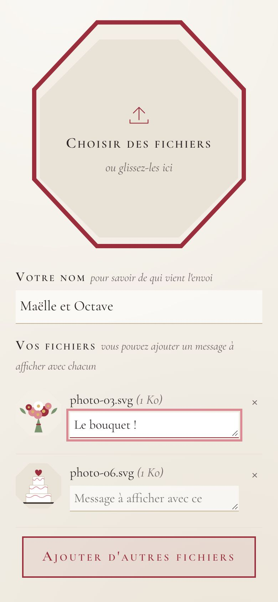
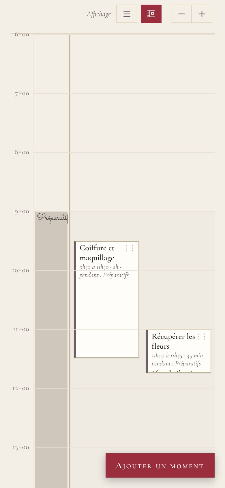
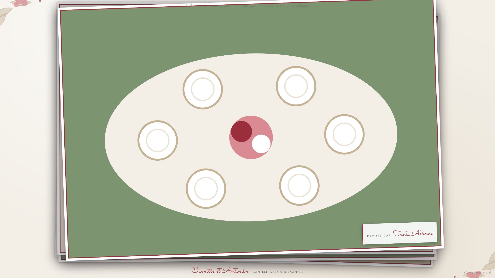

# Souvenirs et projection de mariage

Un modèle de site web pour un mariage : les invités déposent leurs photos, leurs vidéos et leurs mots depuis leur téléphone, et le tout est projeté en continu pendant la soirée.

La page de dépôt est **optimisée pour le smartphone** : elle s'ouvre avec un QR code posé sur les tables, sans compte ni application.

**Tout ce qui est propre à un mariage se règle dans un seul fichier, `donnees.js`**, sans toucher au code. Il n'y a rien à installer, et les pages s'hébergent gratuitement.

**[Voir la démonstration en ligne](https://famickael.github.io/projection-mariage/)**

> **In English.** A reusable template for a wedding keepsake site: guests upload photos, videos and notes from their phone, and everything is shown as a live slideshow during the party. It is a static site with no build step, backed by a Supabase project, and all wedding-specific content lives in a single file, `donnees.js`. The pages, the sample data and the documentation are in French.

<table>
  <tr>
    <td></td>
    <td></td>
    <td></td>
  </tr>
</table>



L'exemple fourni est le mariage de Camille et Antonin. **Toutes les données sont fictives** : prénoms, communes, lieux et dates ont été inventés, et les images sont des dessins.

## Les 4 pages

| Page | Pour qui | Description |
|---|---|---|
| `index.html` | Les invités | Accueil aux couleurs du mariage, puis dépôt de photos, de vidéos et de fichiers, avec un mot pour chacun |
| `projection.html` | L'écran de la soirée | Diaporama en continu, où les nouveaux envois passent en priorité |
| `admin.html` | Les organisateurs | Modération, correction des noms et des mots, téléchargement de tout en zip |
| `programme.html` | Les témoins | Déroulé partagé du week-end, en liste ou en planning, à l'abri des mariés |

## Fonctions

| Fonction | Description |
|---|---|
| Dépôt sans compte | Un nom, des fichiers, un mot facultatif par fichier |
| Gros fichiers | Envoi par morceaux, avec reprise après une coupure de réseau et temps restant affiché |
| Confidentialité | Un invité dépose mais ne voit aucun envoi, pas même les siens |
| Modération | Chaque envoi et chaque fichier peut être retiré de la projection, corrigé ou supprimé |
| Projection | Photos, vidéos et mots, mélangés, avec le nom de l'invité |
| Coupure de réseau | Les médias sont gardés en mémoire, la projection continue hors ligne |
| Archive | Téléchargement de tous les souvenirs en un fichier zip, et export des mots en CSV |
| Programme | Moments déplaçables, moments verrouillés, phases de la journée, repère de l'heure en cours |
| Démonstration | Sans réglage, les 4 pages s'ouvrent avec un contenu fictif et rien n'est envoyé |

## Démarrer

1. **Copiez le dépôt** avec le bouton « Use this template », de préférence en dépôt privé.
2. **Ouvrez `donnees.js`** et remplacez les prénoms, la date et les lieux fictifs par les vôtres.
3. **Créez le projet Supabase** qui recevra les souvenirs, en suivant [l'installation](docs/installation.md). Comptez 20 minutes.
4. **Publiez** : dans les réglages du dépôt, rubrique « Pages », choisissez « Deploy from a branch », puis la branche `main` et le dossier `/ (root)`.
5. **Faites un essai complet** depuis un téléphone avant d'imprimer le QR code.

Le début de `donnees.js` ressemble à ceci :

```js
maries: ["Camille", "Antonin"],
phrase: "ont la joie de vous inviter à leur mariage",
date: "Samedi 12 juin 2027",
moments: [
  { icone: "eglise", titre: "Cérémonie", lignes: ["à 15h00", "à l'église de Saint-Aubrin"] }
]
```

Tous les champs sont décrits dans [la référence de `donnees.js`](docs/donnees.md).

## Contenu du dépôt

| Fichier | Rôle | À modifier ? |
|---|---|---|
| `donnees.js` | Prénoms, date, temps forts, jours du programme, branchement Supabase | Oui |
| `couple.svg` | Image de l'accueil | Oui, à remplacer par votre photo |
| `index.html`, `admin.html`, `projection.html`, `programme.html` | Les 4 pages : structure, styles et script | Seulement pour changer l'apparence ou le fonctionnement |
| `supabase/` | Schéma à exécuter dans Supabase, et script de fermeture après le mariage | Non |
| `demo/` | Données et dessins du mode démonstration | Non |
| `.nojekyll` | Fichier vide qui demande à GitHub Pages de publier les fichiers tels quels | Non |
| `AGENTS.md`, `CLAUDE.md` | Guide pour les assistants IA qui modifient le projet | Non |
| `CHANGELOG.md` | Historique des révisions | À chaque évolution |
| `docs/` | Documentation et captures d'écran | Non |

## Photos et vie privée

Les souvenirs sont enregistrés dans **votre** projet Supabase, dans un espace privé. Les invités ne peuvent que déposer. La lecture demande un compte, que vous créez vous-même pour chaque organisateur.

Avant d'utiliser le modèle pour un vrai mariage, 3 points sont à connaître :

- Une page GitHub Pages est accessible à toute personne qui en connaît l'adresse : n'importe qui peut donc déposer un fichier. La modération se fait dans `admin.html`.
- Un dépôt public conserve l'historique de toutes ses versions, photo du couple comprise. Pour un vrai mariage, un dépôt privé est préférable.
- Vous êtes responsable des photos déposées : accord des personnes, durée de conservation, suppression à la demande. Le téléchargement de l'archive et la fermeture du service sont à prévoir dès le départ.

## Documentation

| Page | Contenu |
|---|---|
| [Installation](docs/installation.md) | Le projet Supabase, les comptes, la publication, l'essai avant le mariage |
| [Référence de `donnees.js`](docs/donnees.md) | Les rubriques du fichier et leurs champs |
| [Le jour du mariage et après](docs/utilisation.md) | La projection et ses raccourcis, la modération, l'archive, la fermeture |
| [Adapter le modèle avec une IA](docs/avec-une-ia.md) | Ce qui est prévu pour les assistants, et des demandes prêtes à copier |
| [Précautions d'usage et limites](docs/precautions.md) | Données personnelles, droits d'accès, services externes, limites connues du code |

## Tester en local

Les pages ont besoin d'un petit serveur local :

```bash
python3 -m http.server 8000
```

Le site est alors disponible à l'adresse `http://localhost:8000`, en démonstration tant que `donnees.js` ne contient pas d'adresse Supabase.

## Contribuer

Les suggestions et les signalements de problèmes sont les bienvenus dans les [issues](../../issues) du dépôt.

## Origine et licence

Ce site a été conçu et écrit avec Claude, l'assistant d'Anthropic : la version d'origine en septembre et octobre 2026, pour un mariage réel, puis la révision qui en a fait un modèle réutilisable, en novembre 2026. Les dates et le contenu de chaque révision sont tenus dans [l'historique des révisions](CHANGELOG.md).

La question de savoir si un contenu produit avec une intelligence artificielle peut être protégé par le droit d'auteur reste discutée. Plutôt que de revendiquer des droits incertains, le choix a été fait de verser l'ensemble au domaine public.

Le contenu de ce dépôt est donc placé sous licence [Creative Commons Zero 1.0](LICENSE). Il peut être copié, modifié et réutilisé librement, sans autorisation ni mention obligatoire.
