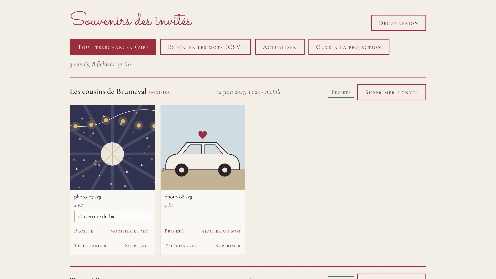
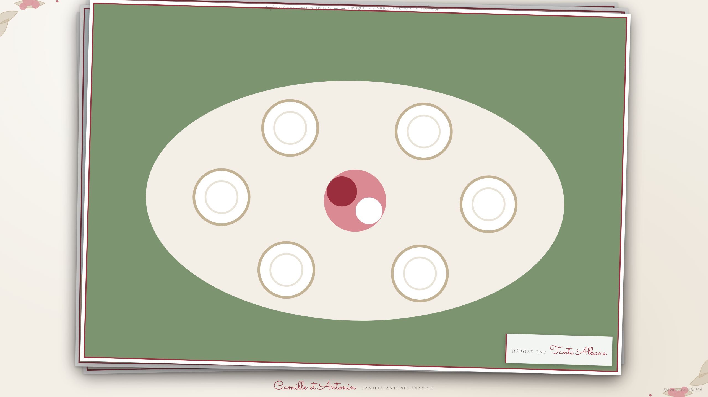

# Souvenirs et projection de mariage

Un modèle de site web pour les personnes qui organisent un mariage : les invités déposent leurs photos, leurs vidéos et leurs mots, et le tout est projeté en continu pendant la soirée.

Le site réunit 4 pages, chacune pour un public. La page de dépôt est **optimisée pour le smartphone** : elle s'ouvre pendant la fête avec un QR code (un code à photographier, qui mène à la page) posé sur les tables, sans compte ni application. La projection tourne sur l'ordinateur relié à l'écran de la salle.

| Page | Pour qui | Rôle | Démonstration |
|---|---|---|---|
| Dépôt des souvenirs | Les invités, sans compte | Envoyer des photos, des vidéos et un mot | [Ouvrir](https://famickael.github.io/projection-mariage/) |
| Administration | Les organisateurs, avec un compte | Vérifier les photos et les mots, les corriger, les retirer, tout télécharger | [Ouvrir](https://famickael.github.io/projection-mariage/admin.html) |
| Projection | L'écran de la soirée | Faire défiler les souvenirs en continu, dès leur arrivée | [Ouvrir](https://famickael.github.io/projection-mariage/projection.html) |
| Programme | L'équipe qui organise | Tenir le déroulé du week-end à plusieurs, à l'abri des mariés | [Ouvrir](https://famickael.github.io/projection-mariage/programme.html) |

> **In English.** A reusable template for a wedding keepsake site, made of 4 pages: guest upload, moderation, live slideshow and a shared schedule for the organizing team. It is a static site with no build step, backed by a Supabase project, and all wedding-specific content lives in a single file, `donnees.js`. The pages, the sample data and the documentation are in French.

<table>
  <tr>
    <td></td>
    <td></td>
  </tr>
  <tr>
    <td></td>
    <td></td>
  </tr>
</table>

L'exemple fourni est le mariage de Camille et Antonin. **Toutes les données sont fictives** : prénoms, communes, lieux et dates ont été inventés, et les images sont des dessins, sans aucune personne réelle.

## Fonctions

| Fonction | Description |
|---|---|
| Dépôt sans compte | Un nom, des fichiers, un mot facultatif par fichier |
| Gros fichiers | Envoi par morceaux, avec reprise après une courte coupure de réseau et temps restant affiché |
| Modération | Chaque envoi et chaque fichier peut être retiré de la projection, corrigé ou supprimé |
| Projection | Photos et vidéos mélangées, avec le mot et le nom de l'invité. Un nouvel envoi passe en priorité |
| Coupure de réseau | Les médias sont gardés en mémoire, la projection continue hors ligne |
| Archive | Téléchargement de tous les souvenirs en un fichier zip, et export des mots dans un fichier CSV, lisible par un tableur |
| Programme | Moments déplaçables, moments verrouillés, phases de la journée, repère de l'heure en cours |
| Démonstration | Sans aucun réglage, les 4 pages s'ouvrent avec un contenu fictif et rien n'est envoyé |

## Démarrer

1. **Copiez le dépôt** avec le bouton « Use this template », de préférence en dépôt privé.
2. **Ouvrez `donnees.js`** et remplacez les prénoms, la date et les lieux fictifs par les vôtres.
3. **Vérifiez le fichier** en ouvrant la page de dépôt avec `?verifier` à la fin de l'adresse.
4. **Créez l'espace qui recevra les souvenirs** chez Supabase, un service en ligne de base de données et de stockage de fichiers, en suivant [l'installation](docs/installation.md).
5. **Publiez** : dans les réglages du dépôt, rubrique « Pages », choisissez « Deploy from a branch », puis la branche `main` et le dossier `/ (root)`.
6. **Faites un essai complet** depuis un téléphone avant d'imprimer le QR code.

Le début de `donnees.js` ressemble à ceci :

```js
maries: ["Camille", "Antonin"],
date: "Samedi 12 juin 2027",
moments: [
  { icone: "eglise", titre: "Cérémonie", lignes: ["à 15h00", "à l'église de Saint-Aubrin"] }
]
```

## Contenu du dépôt

| Fichier | Rôle | À modifier ? |
|---|---|---|
| `donnees.js` | Prénoms, date, temps forts, jours du programme, options, branchement Supabase | Oui |
| `couple.svg` | Image de l'accueil | Oui, à remplacer par votre photo |
| `index.html`, `admin.html`, `projection.html`, `programme.html` | Les 4 pages : dépôt, administration, projection, programme | Seulement pour changer l'apparence ou le fonctionnement |
| `verifier.js` | Contrôle de `donnees.js`, lancé par `?verifier` | Non |
| `supabase/` | Scripts à exécuter dans Supabase : création, option d'accès restreint, fermeture | Non |
| `demo/` | Données et dessins du mode démonstration | Non |
| `.nojekyll` | Fichier vide qui demande à GitHub Pages de publier les fichiers tels quels | Non |
| `AGENTS.md`, `CLAUDE.md` | Guide pour les assistants IA qui modifient le projet | Non |
| `CHANGELOG.md` | Historique des révisions | À chaque évolution |
| `docs/` | Documentation et captures d'écran | Non |

## Photos et vie privée

Les souvenirs sont enregistrés dans votre propre espace Supabase. La page de dépôt n'affiche aucun envoi. Avant un vrai mariage, 3 points sont à connaître :

- Par défaut, la projection et le programme s'ouvrent sans compte : toute personne qui en connaît l'adresse peut les voir. Une [option](docs/options.md) demande un compte sur ces 2 pages.
- Le dépôt est ouvert à toute personne qui a l'adresse de la page. La modération se fait dans l'administration.
- Un dépôt GitHub public conserve l'historique de toutes ses versions, photo du couple comprise. Pour un vrai mariage, un dépôt privé est préférable.

## Documentation

| Page | Contenu |
|---|---|
| [Installation](docs/installation.md) | L'espace Supabase, les comptes, la publication, l'essai avant le mariage |
| [Référence de `donnees.js`](docs/donnees.md) | Les rubriques du fichier, leurs champs, la vérification |
| [Personnaliser et options](docs/options.md) | La photo, les couleurs, l'accès par compte à la projection et au programme |
| [Le jour du mariage et après](docs/utilisation.md) | Les 4 pages en usage, les raccourcis de la projection, l'archive, la fermeture |
| [Adapter le modèle avec une IA](docs/avec-une-ia.md) | Ce qui est prévu pour les assistants, et des demandes prêtes à copier |
| [Précautions d'usage et limites](docs/precautions.md) | Données personnelles, droits d'accès, services externes, ce qui n'a pas été testé |
| [Étude de cas](docs/etude-de-cas.md) | Le besoin, les publics, les choix de conception, les pistes d'évolution |

## Tester en local

```bash
python3 -m http.server 8000
```

Le site est alors disponible à l'adresse `http://localhost:8000`, en démonstration tant que `donnees.js` ne contient pas d'adresse Supabase.

## Contribuer

Les suggestions et les signalements de problèmes sont les bienvenus dans les [issues](../../issues) du dépôt.

## Origine et licence

Ce site a été conçu et écrit avec Claude, l'assistant d'Anthropic : la version d'origine du 14 septembre au 10 octobre 2026, pour un mariage réel, puis la révision qui en a fait un modèle réutilisable, en novembre 2026. Le détail est tenu dans [l'historique des révisions](CHANGELOG.md).

Le contenu de ce dépôt est placé sous licence [Creative Commons Zero 1.0](LICENSE). Il peut être copié, modifié et réutilisé librement, sans autorisation ni mention obligatoire.
